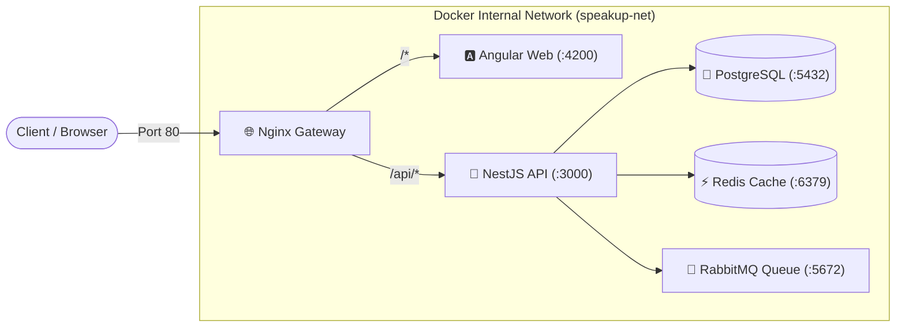

<div align="center">

# 🎙️ SpeakUp — English Learning Application
### Nền tảng học tiếng Anh giao tiếp & luyện phát âm phản xạ thông minh

[](https://www.docker.com/)
[](https://nginx.org/)
[](https://angular.dev/)
[](https://nestjs.com/)
[](https://www.postgresql.org/)
[](https://redis.io/)
[](https://www.rabbitmq.com/)

---

*Dự án phục vụ mục tiêu kép: **Thực hành làm chủ công nghệ doanh nghiệp** (DevOps, Microservice architecture) và **Xây dựng ứng dụng học tiếng Anh** cá nhân hóa hàng ngày.*

</div>

---

## ⚡ Khởi động nhanh dự án trong 3 bước (Quick Start)

Dự án được container hóa hoàn chỉnh bằng **Docker Compose**. Bạn chỉ cần 3 bước đơn giản là toàn bộ 6 dịch vụ sẽ tự động thức dậy:

```bash
# Bước 1: Chuẩn bị file biến môi trường từ mẫu
cp .env.example .env

# Bước 2: Build và khởi động toàn bộ cụm container (chạy ngầm)
docker compose up -d --build

# Bước 3: Kiểm tra trạng thái các dịch vụ
docker compose ps
```

---

## 🌐 Danh mục cổng & Địa chỉ truy cập dịch vụ

Sau khi khởi động thành công, toàn bộ hệ thống được phân phối qua các cổng sau:

| Dịch vụ | Địa chỉ URL | Cổng Host | Tài khoản / Thông tin |
| :--- | :--- | :---: | :--- |
| **🌐 Web App (Angular)** | [http://localhost:8080](http://localhost:8080) | `8080` (Nginx) | Giao diện học tập người dùng |
| **🚀 Backend API (NestJS)** | [http://localhost:8080/api/health](http://localhost:8080/api/health) | `8080` (Nginx) | API trạng thái hệ thống |
| **🐰 Quản trị RabbitMQ** | [http://localhost:15672](http://localhost:15672) | `15672` | User: `speakup_rabbit`<br>Pass: `rabbit_secret_pass` |
| **🐘 PostgreSQL Database** | `localhost:5432` | `5432` | DB: `speakup_db`<br>User: `speakup_user`<br>Pass: `speakup_secret_pass` |
| **⚡ Redis In-Memory** | `localhost:6379` | `6379` | Pass: `redis_secret_pass` |

---

## 🏗️ Kiến trúc tổng thể hệ thống



---

## 📚 Tài liệu chi tiết & Hướng dẫn tra cứu

- 📖 **[Cẩm nang khởi động & Gỡ lỗi từ A-Z](./docs/GETTING_STARTED.md):** Hướng dẫn chi tiết từng câu lệnh, cách kiểm tra dữ liệu và sửa lỗi thường gặp.
- 📐 **[Sơ đồ kiến trúc hạ tầng](./docs/architecture/01-docker-infrastructure.md):** Chi tiết cấu hình mạng, cổng, volume và luồng phụ thuộc healthchecks.
- 🎓 **[Cẩm nang vai trò công nghệ](./docs/architecture/02-tech-stack-roles.md):** Giải thích trực quan tại sao dùng Nginx, RabbitMQ, Redis, Postgres trong bài toán học tiếng Anh.
- 📅 **[Nhật ký kế hoạch hàng ngày](./plans/):** Theo dõi tiến độ cuốn chiếu của dự án.
