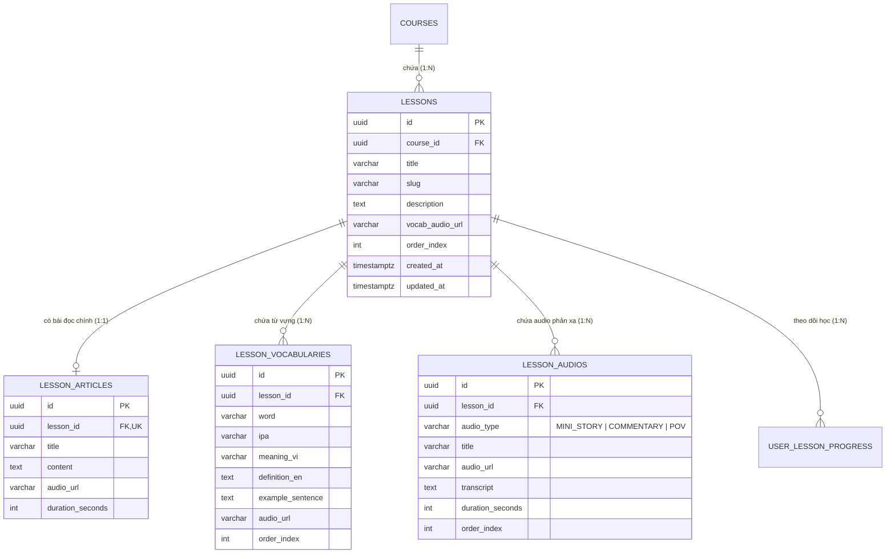
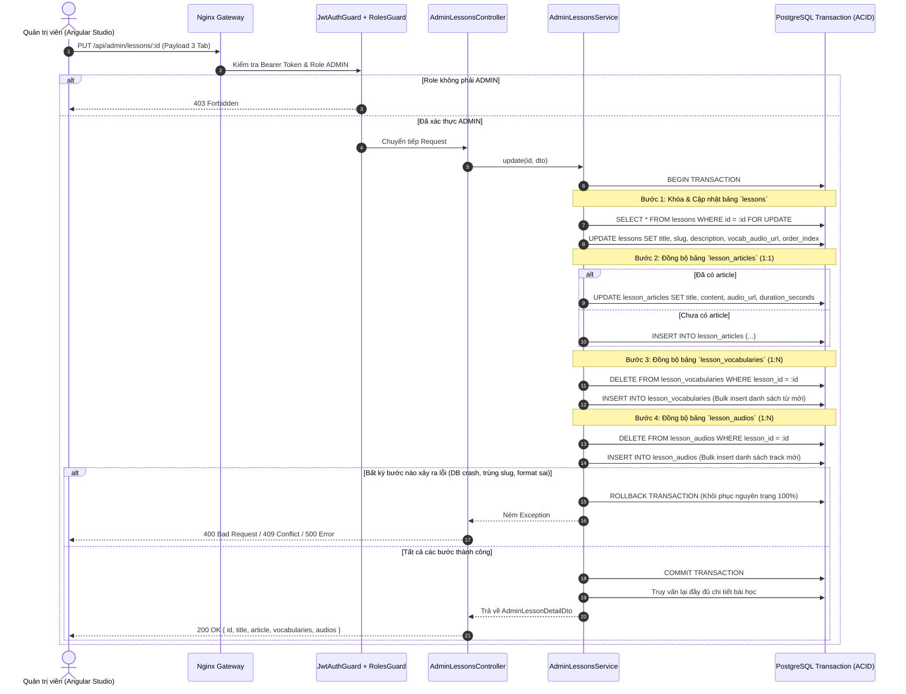

# 🛠️ [API Spec] Studio Biên Tập Bài Học & Giao Dịch Đa Bảng (Lesson Studio Transaction)

- **Phân hệ:** Admin CMS & Content Management
- **Endpoints:**
  - `POST /api/admin/courses/:courseId/lessons` (Tạo bài học mới kèm nội dung 3 tab)
  - `PUT /api/admin/lessons/:id` (Cập nhật toàn diện bài học kèm nội dung 3 tab)
  - `GET /api/admin/lessons/:id` (Lấy chi tiết bài học đầy đủ kèm quan hệ)
  - `DELETE /api/admin/lessons/:id` (Xóa bài học và cascading toàn bộ dữ liệu phụ trợ)
- **Quyền hạn (RBAC):** Bắt buộc `@Roles(UserRole.ADMIN)` qua `RolesGuard`
- **Tần suất giới hạn (Rate Limit):** 100 requests/phút

---

## 1. Mục Tiêu Nghiệp Vụ & Bài Toán Kỹ Thuật

Phương pháp Effortless English yêu cầu mỗi bài học không chỉ là một bài đọc đơn thuần, mà là một **tổ hợp học tập đa thành phần** gồm 3 khối dữ liệu gắn kết hữu cơ:
1. **Bài đọc chính (Article):** Nội dung câu chuyện (Story Text/HTML với các từ mới bôi đậm qua `<mark>...</mark>`), link file audio đọc truyện, thời lượng.
2. **Từ vựng trọng tâm (Vocabularies):** Danh sách từ vựng, phiên âm IPA, nghĩa tiếng Việt, định nghĩa tiếng Anh, câu ví dụ và audio phát âm riêng biệt.
3. **Audio phản xạ (Multi-track Audios):** Các bài nghe độc quyền gồm **Mini-Story** (luyện hỏi đáp phản xạ cực nhanh), **POV - Point of View** (ngấm ngữ pháp tự nhiên qua các thì quá khứ/hiện tại/tương lai), **Commentary** (bình luận tư duy & năng lượng tích cực), kèm transcript lời thoại.

### ⚠️ Thách thức kỹ thuật:
- Nếu lưu từng bảng riêng biệt bằng các API rời rạc (`/api/article`, `/api/vocabularies`...): Khi người dùng đang lưu mà mất mạng hoặc 1 bảng bị lỗi, cơ sở dữ liệu sẽ bị rơi vào trạng thái **bán thành phẩm (Partial state / Corrupted data)**: có bài học nhưng mất audio, hoặc có từ vựng nhưng không có bài đọc.
- **Giải pháp bắt buộc:** Toàn bộ quá trình tạo mới hoặc cập nhật 3 tab phải được bọc trong một **Database Transaction nguyên tử (ACID)**. Thành công thì cùng lưu, thất bại thì rollback 100%.

---

## 2. Sơ Đồ Thực Thể & Quan Hệ Dữ Liệu (ERD)



---

## 3. Sơ Đồ Luồng Xử Lý Giao Dịch (Transactional Flow)



---

## 4. Đặc Tả DTO & Quy Tắc Validation (class-validator)

Hệ thống kích hoạt `ValidationPipe({ whitelist: true, forbidNonWhitelisted: true })`. Client **TUYỆT ĐỐI KHÔNG** được gửi thừa hoặc sai tên trường, nếu không server sẽ trả về `400 Bad Request`.

### 4.1. Cấu trúc Payload chuẩn:
```json
{
  "title": "Day 1: A Kiss - Power English",
  "slug": "a-kiss",
  "description": "Bài học mở đầu phương pháp Effortless English của thầy AJ Hoge",
  "vocabAudioUrl": "https://assets.speakup.internal/audio/a-kiss-vocab.mp3",
  "orderIndex": 1,
  "article": {
    "title": "A Kiss - Main Story",
    "content": "Carlos buys a new car. It is a <mark>huge</mark>, blue, fast car...",
    "audioUrl": "https://assets.speakup.internal/audio/a-kiss-story.mp3",
    "durationSeconds": 154
  },
  "vocabularies": [
    {
      "word": "huge",
      "ipa": "/hjuːdʒ/",
      "meaningVi": "Khổng lồ, cực kỳ to lớn",
      "definitionEn": "Extremely large; enormous",
      "exampleSentence": "It is a huge, blue, fast car.",
      "audioUrl": "https://assets.speakup.internal/audio/vocab/huge.mp3",
      "orderIndex": 1
    }
  ],
  "audios": [
    {
      "audioType": "MINI_STORY",
      "title": "Mini-Story A - A Kiss",
      "audioUrl": "https://assets.speakup.internal/audio/a-kiss-mini-story-a.mp3",
      "durationSeconds": 620,
      "orderIndex": 1,
      "transcript": "Carlos bought a new car. Did Carlos buy a new car? Yes, he did..."
    }
  ]
}
```

---

## 5. Danh Mục Mã Lỗi Nghiệp Vụ (Error Matrix)

| HTTP Status | Error Code / Message | Nguyên Nhân Gốc Rễ | Hành Vi Frontend Studio |
| :---: | :--- | :--- | :--- |
| `400` | `property [x] should not exist` | Gửi thừa field không có trong DTO (VD: `durationMinutes`, `contentHtml`) | Cần loại bỏ field trước khi post |
| `400` | `article.content should not be empty` | Để trống nội dung bài đọc | Focus vào textarea bài đọc |
| `400` | `vocabularies.X.word should not be empty` | Thêm thẻ từ vựng nhưng không nhập từ tiếng Anh | Focus vào input từ vựng dòng X |
| `400` | `audios.X.audioType must be one of the following values...` | Loại audio sai enum (phải là `MINI_STORY`, `COMMENTARY`, `POV`) | Chọn lại dropdown |
| `401` | `Unauthorized` | Không có Bearer JWT hoặc Token đã hết hạn | Điều hướng về `/login` |
| `403` | `Access denied: Required role [ADMIN]` | User là học viên thường | Chuyển hướng về `/courses` |
| `404` | `Bài học với ID [x] không tồn tại` | Bài học đã bị xóa ở tab khác | Tải lại danh sách bài học |
| `409` | `Slug '[x]' đã tồn tại trong khóa học này` | Đặt trùng slug với bài học khác trong cùng khóa | Báo đỏ trường slug, yêu cầu đổi |
| `500` | `Internal Server Error` | Lỗi database đứt kết nối / deadlock | Tự động rollback, hiển thị nút Thử lại |

---

## 6. Chiến Lược Dọn Rác & Ràng Buộc Khóa Ngoại (Cascade Strategy)

Khi xóa bài học qua `DELETE /api/admin/lessons/:id`:
- Trong Entity TypeORM, các bảng con (`lesson_articles`, `lesson_vocabularies`, `lesson_audios`, `user_lesson_progress`) đều được khai báo:
  `@ManyToOne(..., { onDelete: 'CASCADE' })`
- Cơ sở dữ liệu PostgreSQL đảm bảo tính toàn vẹn cấp Engine: Khi bản ghi `lessons` bị xóa, toàn bộ hàng liên quan trong 4 bảng con sẽ tự động được xóa sạch sẽ trong microsecond mà không để lại rác (Orphan records).
