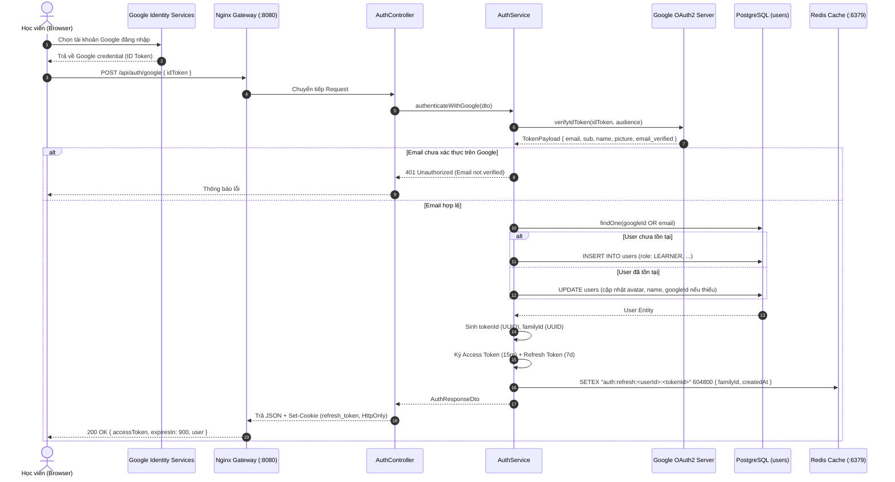
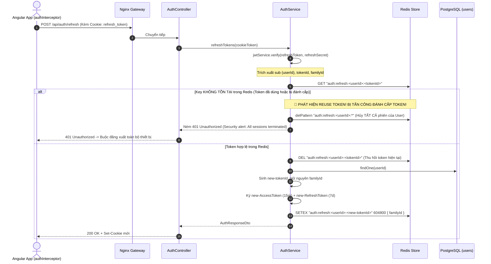

# 🔐 [API Spec] Xác Thực Người Dùng & Quản Lý Phiên (Auth & Dual-Token Rotation)

- **Phân hệ:** Authentication & Security
- **Endpoints:**
  - `POST /api/auth/google` (Đăng nhập Google OAuth 2.0 & Cấp Dual Token)
  - `POST /api/auth/refresh` (Xoay vòng Refresh Token & Cấp Access Token mới)
  - `POST /api/auth/logout` (Thu hồi phiên làm việc & Hủy bỏ Refresh Token trong Redis)
  - `GET /api/auth/me` (Lấy thông tin tài khoản đang đăng nhập)
- **Quyền hạn (RBAC):** Public (Google/Refresh/Logout), Authenticated (`GET /api/auth/me`)
- **Tần suất giới hạn (Rate Limit):** 100 requests/phút (Global Throttler)

---

## 1. Mục Tiêu Nghiệp Vụ & Kiến Trúc Dual-Token

Hệ thống học tập SpeakUp đòi hỏi trải nghiệm liền mạch cho học viên (nghe audio nhiều giờ không bị ngắt quãng đăng nhập lại), đồng thời phải đạt chuẩn an toàn thông tin cao cấp:

1. **Access Token (Short-lived - 15 phút):**
   - Định dạng: JWT (HMAC-SHA256) chứa `sub` (User ID), `email`, `role`, `type: 'access'`.
   - Vị trí lưu trữ Client: Bộ nhớ RAM (Angular Signal) + LocalStorage.
   - Truyền tải: Gửi kèm tiêu đề HTTP `Authorization: Bearer <access_token>`.
2. **Refresh Token (Long-lived - 7 ngày):**
   - Định dạng: JWT (HMAC-SHA256) ký bằng secret riêng (`JWT_REFRESH_SECRET`) chứa `sub`, `tokenId` (UUID v4), `familyId` (UUID v4), `type: 'refresh'`.
   - Vị trí lưu trữ Client: **HttpOnly Cookie** (`refresh_token`, `SameSite=Lax`, `Secure` trên Production) chống tấn công XSS hoàn toàn.
   - Vị trí lưu trữ Server: **Redis Key-Value** với TTL 7 ngày: `auth:refresh:<userId>:<tokenId>`.
3. **Cơ chế Refresh Token Rotation (Xoay vòng Token):**
   - Mỗi lần Client dùng Refresh Token để lấy Access Token mới, Refresh Token đó sẽ **bị hủy ngay lập tức** và một cặp Dual-Token hoàn toàn mới được sinh ra.
4. **Cơ chế Phát Hiện Tái Sử Dụng Token (Token Reuse Detection):**
   - Nếu một Refresh Token cũ đã bị xoay vòng (không còn tồn tại trong Redis) nhưng lại được gửi lên server ➔ **Hệ thống phát hiện có kẻ gian đánh cắp token** ➔ Lập tức thu hồi (purge) **TOÀN BỘ phiên đăng nhập** của User đó trong Redis và chặn truy cập ngay.

---

## 2. Sơ Đồ Luồng Nghiệp Vụ (Sequence Diagrams)

### 2.1. Đăng nhập Google SSO (`POST /api/auth/google`)



---

### 2.2. Xoay vòng Refresh Token & Phát hiện Tấn công (`POST /api/auth/refresh`)



---

## 3. Tác Động Cơ Sở Dữ Liệu & Lưu Trữ Phiên (Storage Impact)

### 3.1. PostgreSQL (`users` Table)
- **Truy vấn khi Login:**
  ```sql
  SELECT * FROM users 
  WHERE google_id = $1 OR email = $2 
  LIMIT 1;
  ```
- **Chỉ mục tối ưu:**
  - `users_pkey` (`id` UUID PRIMARY KEY)
  - `users_email_key` (`email` UNIQUE INDEX)
  - `users_google_id_key` (`google_id` UNIQUE INDEX)

### 3.2. Redis In-Memory Key Design
| Key Pattern | Cấu trúc dữ liệu | Giá trị lưu trữ | TTL | Mục đích |
| :--- | :---: | :--- | :---: | :--- |
| `auth:refresh:{userId}:{tokenId}` | String | JSON `{ familyId, createdAt, userAgent }` | 604,800 giây (7 ngày) | Theo dõi trạng thái active của Refresh Token theo từng thiết bị. |

---

## 4. Xử Lý Concurrency & Khử Lặp Gọi API Phía Frontend

Trong ứng dụng Angular, khi Access Token 15 phút vừa hết hạn, nếu học viên mở trang tải đồng thời 5 request API (`/api/courses`, `/api/auth/me`, `/api/learning/progress`...):
- Cả 5 request sẽ đồng thời nhận `401 Unauthorized`.
- Nếu cả 5 request đều gọi `POST /api/auth/refresh`, request đầu tiên sẽ thu hồi token, 4 request sau sẽ bị coi là **Token Reuse** và học viên bị văng ra ngoài bất đắc dĩ!

### ✅ Giải pháp triệt để: In-flight Request Deduplication trong [`AuthService`](file:///d:/MY_PROJECT/speak-up/apps/web/src/app/core/services/auth.service.ts)
```typescript
private refreshInFlight$: Observable<AuthResponse> | null = null;

refreshToken(): Observable<AuthResponse> {
  if (!this.refreshInFlight$) {
    this.refreshInFlight$ = this.http
      .post<AuthResponse>(`${environment.apiUrl}/auth/refresh`, {}, { withCredentials: true })
      .pipe(
        tap((res) => this.setSession(res)),
        finalize(() => {
          this.refreshInFlight$ = null; // Giải phóng khi xong
        }),
        shareReplay(1) // Chia sẻ chung 1 response duy nhất cho tất cả các subscriber cùng thời điểm
      );
  }
  return this.refreshInFlight$;
}
```
Nhờ `shareReplay(1)` và cờ `X-Auth-Retry` trong [`authInterceptor`](file:///d:/MY_PROJECT/speak-up/apps/web/src/app/core/interceptors/auth.interceptor.ts), toàn bộ 5 request chờ chung kết quả của 1 lần refresh duy nhất, loại bỏ hoàn toàn Race Condition.

---

## 5. Danh Mục Mã Lỗi Nghiệp Vụ (Error Matrix)

| HTTP Status | Message Phản Hồi | Nguyên Nhân | Hành Vi Xử Lý Phía Client |
| :---: | :--- | :--- | :--- |
| `400` | `Bad Request: idToken should not be empty` | Client gửi body rỗng hoặc thiếu token | Báo lỗi đăng nhập Google |
| `401` | `Invalid or expired Google token` | Token Google đã quá hạn hoặc sai Client ID | Mở lại popup Google SSO |
| `401` | `Google account does not provide an email address` | Tài khoản Google bị ẩn email | Thông báo cần cấp quyền email |
| `401` | `Google email address is not verified` | Email Google chưa xác nhận bảo mật | Yêu cầu xác thực tài khoản Google |
| `401` | `Invalid or expired refresh token` | Refresh token hết hạn 7 ngày hoặc sai chữ ký | Xóa localStorage, điều hướng về `/login` |
| `401` | `Security alert: Refresh token reuse detected. All sessions terminated.` | Phát hiện token đã sử dụng bị gọi lại (nghi vấn bị đánh cắp) | Cảnh báo bảo mật, bắt đăng nhập lại từ đầu |
| `403` | `Access denied: Required role [ADMIN], but your role is [LEARNER]` | Learner cố gọi API quản trị | Chuyển hướng về `/courses` |
| `429` | `ThrottlerException: Too Many Requests` | Vượt quá 100 requests/phút | Chặn gửi request, hiển thị đếm ngược |

---

## 6. Kịch Bản Kiểm Thử Xác Minh (Testing Scenarios)

1. **Happy Path Login:** Gửi Google ID Token hợp lệ ➔ Nhận về Access Token và Cookie `refresh_token` ➔ Kiểm tra Redis có key `auth:refresh:<userId>:<tokenId>`.
2. **Happy Path Silent Refresh:** Gọi `POST /api/auth/refresh` với Cookie hợp lệ ➔ Nhận token mới, key cũ trong Redis bị xóa, key mới được tạo.
3. **Attack Scenario (Token Reuse):** Lưu lại refresh token cũ, sau khi đã refresh xong, cố tình gửi lại refresh token cũ đó ➔ Server phải trả về `401`, toàn bộ key `auth:refresh:<userId>:*` trong Redis bị xóa sạch, các session khác trên thiết bị khác cũng bị đăng xuất.
