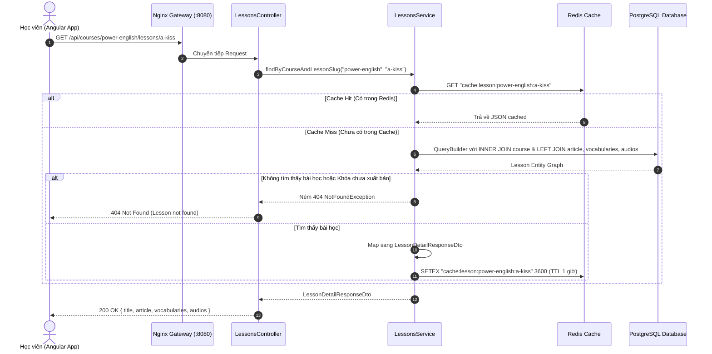

# 🎧 [API Spec] Truy Xuất Khóa Học & Không Gian Học Bài Học (Learner Course & Lesson Access)

- **Phân hệ:** Learner Learning Experience
- **Endpoints:**
  - `GET /api/courses` (Danh sách các khóa học đang phát hành cho học viên)
  - `GET /api/courses/:slug` (Chi tiết khóa học & danh sách các bài học theo thứ tự)
  - `GET /api/courses/:courseSlug/lessons/:lessonSlug` (Tải không gian học bài học toàn diện: Bài đọc, từ vựng, audios phản xạ)
- **Quyền hạn (RBAC):** Public (`GET /api/courses`), Authenticated Learner (`GET /api/courses/:courseSlug/lessons/:lessonSlug`)
- **Tần suất giới hạn (Rate Limit):** 100 requests/phút

---

## 1. Mục Tiêu Nghiệp Vụ & Trải Nghiệm Học Tập (Learner UX)

Không gian học bài học (`Learning Workspace`) là tính năng có thời gian tương tác (Time-on-Page) cao nhất trong ứng dụng SpeakUp. Học viên sẽ:
1. Đọc câu chuyện tiếng Anh với audio phát âm chuẩn của người bản xứ.
2. Tra cứu danh sách từ vựng trọng tâm kèm phát âm từng từ độc lập.
3. Luyện nghe phản xạ với hệ thống track **Mini-Story, POV và Commentary** theo phương pháp Effortless English.

### Yêu cầu kiến trúc:
- **Tải dữ liệu 1 lần duy nhất (Single-roundtrip Loading):** Thay vì để Client gọi 3 request riêng lẻ (`/article`, `/vocabularies`, `/audios`), API gom toàn bộ dữ liệu bài học về trong một lần gọi duy nhất để giảm latency và giúp ứng dụng phản hồi tức thì.
- **Bảo mật nội dung (Publish Status):** Học viên chỉ được xem các khóa học có cờ `is_published = true`. Các khóa bản nháp (Draft) chỉ dành riêng cho Admin trong CMS.

---

## 2. Sơ Đồ Luồng Truy Vấn Không Gian Học Tập (Sequence Diagram)



---

## 3. Tối Ưu Hóa Truy Vấn Cơ Sở Dữ Liệu (SQL & Index Optimization)

### 3.1. Truy Vấn Thực Tế Của `findByCourseAndLessonSlug`:
```sql
SELECT 
    lesson.id, lesson.title, lesson.slug, lesson.order_index, 
    lesson.description, lesson.vocab_audio_url,
    course.id, course.title, course.slug,
    article.id, article.title, article.content, article.audio_url, article.duration_seconds,
    vocabularies.id, vocabularies.word, vocabularies.ipa, vocabularies.meaning_vi, 
    vocabularies.definition_en, vocabularies.example_sentence, vocabularies.audio_url,
    audios.id, audios.audio_type, audios.title, audios.audio_url, audios.duration_seconds, audios.transcript
FROM lessons lesson
INNER JOIN courses course ON course.id = lesson.course_id
LEFT JOIN lesson_articles article ON article.lesson_id = lesson.id
LEFT JOIN lesson_vocabularies vocabularies ON vocabularies.lesson_id = lesson.id
LEFT JOIN lesson_audios audios ON audios.lesson_id = lesson.id
WHERE course.slug = $1 AND lesson.slug = $2
ORDER BY vocabularies.order_index ASC, audios.order_index ASC;
```

### 3.2. Đánh Giá Hiệu Năng & Chỉ Mục (Indexes):
1. **`uq_course_lesson_slug` (Composite Unique Index `course_id + slug`):** Tốc độ quét Index scan $O(\log N)$, triệt tiêu tình trạng Full Table Scan.
2. **`courses_slug_key` (Unique Index `slug` trên `courses`):** Giúp phép `INNER JOIN` khớp chính xác trong microseconds.
3. **Phòng tránh N+1 Query:** Toàn bộ quan hệ được tải thông qua `leftJoinAndSelect` trong 1 query duy nhất, không phát sinh thêm bất kỳ truy vấn lẻ nào cho từng từ vựng hay từng audio.

---

## 4. Chiến Lược Caching Với Redis (Redis Cache Strategy)

| Khóa Cache | TTL | Sự Kiện Invalidate (Xóa Cache) |
| :--- | :---: | :--- |
| `cache:courses:published` | 15 phút | Khi Admin cập nhật hoặc xuất bản khóa học mới (`AdminCoursesService`). |
| `cache:course:{courseSlug}` | 30 phút | Khi Admin sửa tiêu đề/mô tả khóa học hoặc thêm bài học mới. |
| `cache:lesson:{courseSlug}:{lessonSlug}` | 1 giờ | Khi Admin ấn **Lưu Bài Học** trên Studio (`AdminLessonsService.update`). |

---

## 5. Danh Mục Mã Lỗi Nghiệp Vụ (Error Matrix)

| HTTP Status | Error Message | Nguyên Nhân | Hành Vi Phía Giao Diện Học Viên |
| :---: | :--- | :--- | :--- |
| `401` | `Unauthorized` | Token hết hạn khi đang học | Kích hoạt Silent Refresh ngầm; nếu refresh thất bại thì lưu vị trí học vào sessionStorage và chuyển sang `/login` |
| `404` | `Course '[slug]' not found` | Slug khóa học không tồn tại hoặc đã bị ẩn (Draft) | Hiển thị màn hình 404 Empty State với nút "Về trang chủ" |
| `404` | `Lesson '[lessonSlug]' not found in course '[courseSlug]'` | Bài học không tồn tại hoặc đã bị xóa | Thông báo bài học không khả dụng, chuyển sang bài tiếp theo |
| `500` | `Internal Server Error` | Lỗi kết nối Database | Hiển thị thông báo "Hệ thống đang bảo trì, vui lòng tải lại trang" kèm nút Retry |

---

## 6. Kịch Bản Kiểm Thử Xác Minh (Testing Scenarios)

1. **Happy Path:** Gọi `GET /api/courses/power-english/lessons/a-kiss` ➔ Trả về đầy đủ article, danh sách từ vựng được sắp xếp theo `orderIndex ASC`, danh sách audios phụ.
2. **Draft Course Protection:** Một khóa học có `is_published = false` ➔ Học viên gọi API `GET /api/courses` sẽ **không** thấy khóa học này trong danh sách.
3. **Non-existent Lesson:** Gọi slug bài học không tồn tại ➔ Trả về đúng mã `404 Not Found` kèm thông điệp rõ ràng.
