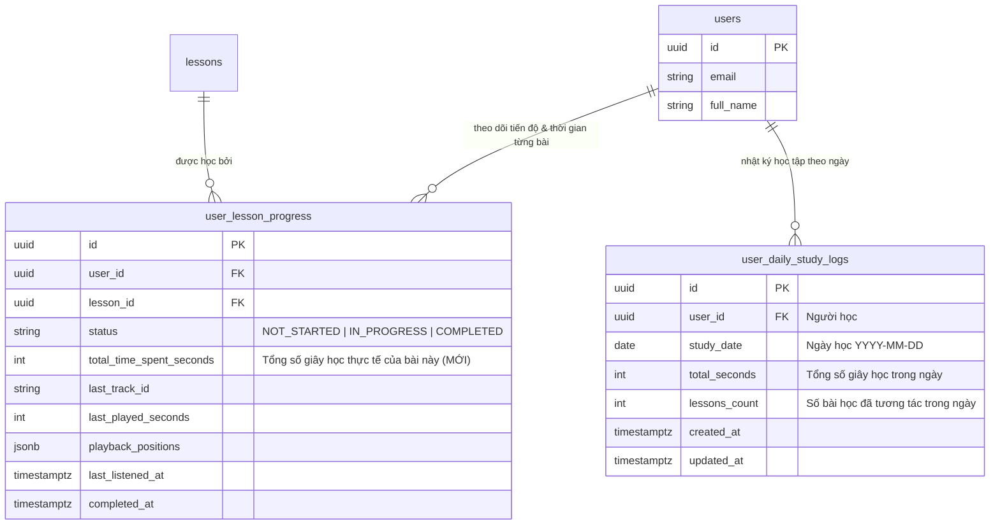
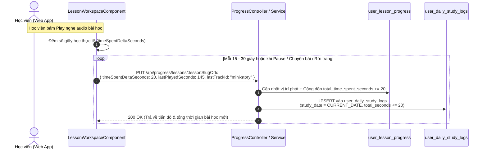
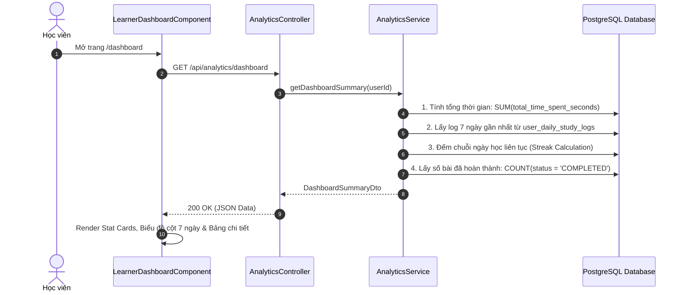

# 📊 [Phân Tích Thiết Kế Chức Năng] Bảng Thống Kê Thời Gian Học Tập & Phân Tích Hoạt Động (Learner Study Time Dashboard & Analytics)

> **Mã phân hệ:** `LEARNER-ANALYTICS`  
> **Phiên bản:** `1.0.0`  
> **Trạng thái:** 🟢 Đã phê duyệt thiết kế (Approved)  
> **Tài liệu liên quan:** `docs/architecture/03-database-erd.md`, `docs/api-specs/learner/course-and-lesson-access.md`

---

## 📌 1. Mục Tiêu Nghiệp Vụ & Bài Toán Người Dùng (Business Value & User Story)

### 1.1. Bối cảnh & Vấn đề (Context & Problem)
Trong phương pháp học tiếng Anh phản xạ sâu (**Effortless English**), quy tắc vàng là: **"Deep Learning & Consistency"** (Học thật sâu và duy trì liên tục mỗi ngày). 
- Trước đây, hệ thống mới chỉ lưu lại *vị trí giây nghe dở* (`last_played_seconds`) để người dùng có thể tiếp tục nghe.
- **Hạn chế:** Người học không biết mình đã dành bao nhiêu thời gian cho bài học này, tuần này mình đã học bao nhiêu giờ, và chuỗi ngày học của mình ra sao. Điều này làm giảm đáng kể động lực học tập (Lack of Habit Loop & Visual Feedback).

### 1.2. Giải pháp (Solution)
Xây dựng phân hệ **Learner Study Time Dashboard & Analytics**:
1. **Thống kê thời lượng học thực tế theo từng bài học (Per-Lesson Time Spent):** Ghi nhận chính xác số phút/giờ người học đã dành cho từng bài học cụ thể (ví dụ: *Bài "A Kiss": Đã học 48 phút, 3 lần nghe*).
2. **Theo dõi thói quen & Chuỗi ngày học liên tục (Daily Streak 🔥):** Tự động duy trì và chúc mừng chuỗi ngày học liên tục khi học viên hoàn thành ít nhất 1 phút học mỗi ngày.
3. **Biểu đồ hoạt động 7 ngày gần nhất (Weekly Activity Chart):** Cung cấp biểu đồ cột tương tác trực quan thể hiện phút học từ Thứ 2 đến Chủ nhật.
4. **Mục tiêu học hàng ngày (Daily Study Goal):** Thanh tiến độ hoàn thành mục tiêu 30 phút mỗi ngày.

---

## 🏗️ 2. Thiết Kế Cơ Sở Dữ Liệu (Database Schema & ERD)



### 2.1. Cập nhật bảng `user_lesson_progress`:
- Bổ sung cột `total_time_spent_seconds` (kiểu `INTEGER`, `DEFAULT 0`, `NOT NULL`): Cộng dồn thời gian học thực tế mỗi khi học viên nghe audio hoặc tương tác trong bài học.

### 2.2. Khởi tạo bảng mới `user_daily_study_logs`:
```sql
CREATE TABLE user_daily_study_logs (
    id UUID PRIMARY KEY DEFAULT gen_random_uuid(),
    user_id UUID NOT NULL REFERENCES users(id) ON DELETE CASCADE,
    study_date DATE NOT NULL,
    total_seconds INTEGER NOT NULL DEFAULT 0,
    lessons_count INTEGER NOT NULL DEFAULT 0,
    created_at TIMESTAMPTZ NOT NULL DEFAULT CURRENT_TIMESTAMP,
    updated_at TIMESTAMPTZ NOT NULL DEFAULT CURRENT_TIMESTAMP,
    CONSTRAINT uq_user_daily_study UNIQUE (user_id, study_date)
);

CREATE INDEX idx_user_daily_study_user_date ON user_daily_study_logs (user_id, study_date DESC);
```

---

## ⚡ 3. Sơ Đồ Luồng Xử Lý Nghiệp Vụ (Sequence Diagrams)

### 3.1. Luồng Tích Lũy Thời Gian Học Thực Tế Từ Phòng Học (Heartbeat / Time Delta Sync)



### 3.2. Luồng Truy Vấn Bảng Thống Kê Tổng Quan (Dashboard Analytics Query)



---

## 🧮 4. Thuật Toán Cốt Lõi (Core Algorithms)

### 4.1. Thuật Toán Tính Chuỗi Ngày Liên Tục (Daily Streak 🔥)
- **Điều kiện tính 1 ngày học hợp lệ:** Ngày đó học viên tích lũy được tối thiểu **60 giây** (`total_seconds >= 60`).
- **Quy tắc đếm Streak:**
  1. Lấy danh sách các `study_date` của học viên sắp xếp giảm dần (`ORDER BY study_date DESC`).
  2. Kiểm tra xem ngày học gần nhất có phải là **Hôm nay** (`CURRENT_DATE`) hoặc **Hôm qua** (`CURRENT_DATE - 1`) không.
     - Nếu ngày gần nhất cách từ 2 ngày trở lên ➔ **Streak = 0** (Đã bị đứt chuỗi).
     - Nếu ngày gần nhất là hôm nay hoặc hôm qua: bắt đầu đếm lùi từng ngày liên tiếp liền kề.
  3. Mỗi ngày lùi về đúng 1 ngày (`expectedDate - 1 day`), tăng biến đếm `streakCount++`. Gặp khoảng trống đầu tiên thì dừng lại.

### 4.2. Thuật Toán Chuẩn Hóa Biểu Đồ 7 Ngày (7-Day Weekly Bucket Filler)
- Lấy 7 ngày gần nhất (từ 6 ngày trước đến hôm nay).
- Truy vấn các bản ghi trong `user_daily_study_logs` trong khoảng này.
- Ghép (merge) với khung 7 ngày cố định: ngày nào học viên không học thì gán giá trị `minutes: 0` để đảm bảo biểu đồ luôn có đầy đủ 7 cột (không bị lệch trục).

### 4.3. Cơ Chế Chống Gian Lận Thời Gian (Anti-idle Protection)
- Tham số `timeSpentDeltaSeconds` gửi từ client lên chỉ được chấp nhận nếu nằm trong khoảng hợp lệ: `1 <= delta <= 60` giây.
- Mọi giá trị `delta > 60` sẽ tự động bị clamp (giới hạn) về tối đa 60 giây để ngăn chặn việc chỉnh sửa client-side hoặc treo máy gian lận.

---

## 📡 5. Đặc Tả Chi Tiết API (API Endpoints Specification)

### 5.1. `GET /api/analytics/dashboard`
- **Mục đích:** Cung cấp toàn bộ dữ liệu tổng quan cho trang Dashboard chính.
- **Quyền hạn:** Authenticated Learner (`Bearer Token`).
- **Response Format (`200 OK`):**
```json
{
  "totalStudyMinutes": 245,
  "todayStudyMinutes": 22,
  "dailyGoalMinutes": 30,
  "goalProgressPercent": 73,
  "currentStreak": 5,
  "completedLessonsCount": 6,
  "inProgressLessonsCount": 3,
  "weeklyActivity": [
    { "date": "2026-11-14", "dayLabel": "Sat", "minutes": 25, "isToday": false },
    { "date": "2026-11-15", "dayLabel": "Sun", "minutes": 40, "isToday": false },
    { "date": "2026-11-16", "dayLabel": "Mon", "minutes": 15, "isToday": false },
    { "date": "2026-11-17", "dayLabel": "Tue", "minutes": 35, "isToday": false },
    { "date": "2026-11-18", "dayLabel": "Wed", "minutes": 30, "isToday": false },
    { "date": "2026-11-19", "dayLabel": "Thu", "minutes": 45, "isToday": false },
    { "date": "2026-11-20", "dayLabel": "Fri", "minutes": 22, "isToday": true }
  ]
}
```

### 5.2. `GET /api/analytics/lessons`
- **Mục đích:** Danh sách chi tiết thời gian học trên từng bài học để hiển thị bảng phân tích.
- **Quyền hạn:** Authenticated Learner (`Bearer Token`).
- **Response Format (`200 OK`):**
```json
[
  {
    "lessonId": "d3b07384-d113-46d4-8d48-356c9e057367",
    "lessonTitle": "A Kiss",
    "lessonSlug": "a-kiss",
    "courseTitle": "Power English",
    "courseSlug": "power-english",
    "totalMinutesSpent": 58,
    "status": "COMPLETED",
    "lastListenedAt": "2026-11-20T11:45:00Z"
  },
  {
    "lessonId": "b1a23384-e223-47f4-8a48-456c9e057388",
    "lessonTitle": "Baseball Pig",
    "lessonSlug": "baseball-pig",
    "courseTitle": "Flow English",
    "courseSlug": "flow-english",
    "totalMinutesSpent": 24,
    "status": "IN_PROGRESS",
    "lastListenedAt": "2026-11-20T12:30:00Z"
  }
]
```

---

## 🎨 6. Thiết Kế Giao Diện Frontend (Angular 18 UI/UX Specification)

Tuân thủ nghiêm ngặt theo **Web Design Backbone Rule**:

### 6.1. Bố Cục Trang `/dashboard`
1. **Header Greeting & Streak Banner:**
   - Lời chào cá nhân hóa: *"Welcome back, [Họ và tên]!"*.
   - Huy hiệu Streak rực rỡ dạng Glassmorphism: `🔥 5 Days Streak — You're on fire!`.
2. **Hàng 4 Thẻ Chỉ Số (Stat Cards - CSS Grid 4 cột):**
   - **Card 1: Tổng thời gian tích lũy** (`Total Time`): Hiển thị định dạng *"4h 05m"* với icon đồng hồ cát gradient xanh lam.
   - **Card 2: Mục tiêu hôm nay** (`Daily Goal`): *"22 / 30 mins (73%)"* kèm thanh progress bar gradient ngọc bích.
   - **Card 3: Bài học hoàn thành** (`Completed`): *"6 Lessons completed"*.
   - **Card 4: Mức độ chăm chỉ** (`Study Habit`): *"Consistent Learner"*.
3. **Khu vực Biểu Đồ Hoạt Động Tuần (Weekly Activity Chart):**
   - Biểu đồ cột SVG + CSS Flexbox thuần, siêu nhẹ, không cần thư viện nặng.
   - Mỗi cột có thanh chiều cao tỷ lệ theo số phút, hover hiển thị tooltip chính xác, ngày hôm nay có hiệu ứng nổi bật (highlight glow).
4. **Bảng Phân Tích Thời Gian Từng Bài Học (Lesson Time Breakdown):**
   - Thanh tìm kiếm bài học nhanh.
   - Bảng hiển thị: Tiêu đề bài học, Tên khóa học, Thời lượng đã học (phút), Trạng thái badge (`Completed` / `In Progress`), Ngày học gần nhất.
   - Cột hành động: Nút **"Continue"** bấm vào chuyển thẳng tới phòng học bài đó.
5. **Đầy đủ 3 trạng thái giao diện (3-State UI):** Skeleton Loading khi đang fetch API, Error State có nút Retry, Empty State nếu là học viên mới chưa bắt đầu học.

---

## ✅ 7. Kế Hoạch Triển Khai Tuần Tự (Execution Plan)

1. **Bước 1:** Khởi tạo nhánh `feature/learner-study-time-dashboard` & Mở rộng Database Entity (`UserLessonProgress`, `UserDailyStudyLog`).
2. **Bước 2:** Xây dựng `AnalyticsModule` (Service, Controller, DTOs) trên Backend NestJS.
3. **Bước 3:** Cập nhật API Progress hỗ trợ cộng dồn `timeSpentDeltaSeconds`.
4. **Bước 4:** Xây dựng Component `LearnerDashboardComponent` trên Angular 18 kết nối các API mới.
5. **Bước 5:** Tích hợp bộ đếm gửi `timeSpentDeltaSeconds` từ `LessonWorkspaceComponent`.
6. **Bước 6:** Kiểm tra chất lượng (Lint 0 lỗi, Build Prod) và chuẩn bị commit/merge.
