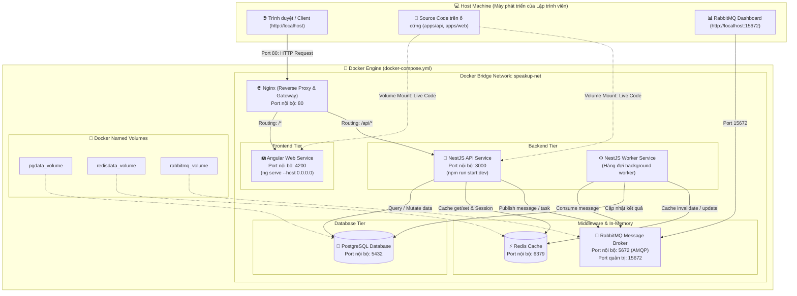
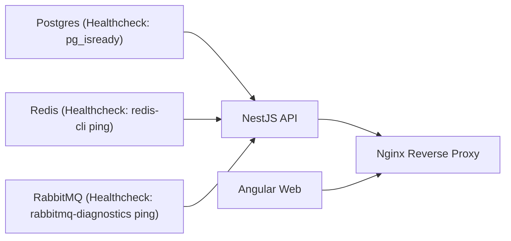

# 🐳 01. Docker Infrastructure & Container Orchestration

Tài liệu chi tiết về hạ tầng Docker Compose của dự án **SpeakUp**, bao gồm sơ đồ mạng, bảng ánh xạ cổng (port mapping), lưu trữ dữ liệu bền vững (volumes) và cơ chế Hot-reload phục vụ môi trường phát triển (Local Development).

---

## 1. Sơ đồ tổng thể kiến trúc Docker (Docker Topology)

---

## 2. Bảng ánh xạ cổng (Port Mapping)

| Service | Tên container | Cổng Container (Nội bộ) | Cổng Host (Bên ngoài) | Mục đích sử dụng |
| :--- | :--- | :---: | :---: | :--- |
| **Nginx** | `speakup-nginx` | `80` | `80` | Cổng duy nhất client truy cập ứng dụng (`http://localhost`) |
| **Angular** | `speakup-web` | `4200` | Không mở (hoặc `4200` khi debug riêng) | Nginx proxy qua cổng này |
| **NestJS** | `speakup-api` | `3000` | Không mở (hoặc `3000` khi debug riêng) | Nginx proxy qua endpoint `/api/*` |
| **PostgreSQL** | `speakup-postgres` | `5432` | `5432` | Kết nối từ DBeaver / TablePlus / PGAdmin trên máy host |
| **Redis** | `speakup-redis` | `6379` | `6379` | Kết nối từ Redis Insight trên máy host |
| **RabbitMQ** | `speakup-rabbitmq` | `5672` / `15672` | `5672` / `15672` | Port `5672` cho AMQP protocol, `15672` cho giao diện Web Admin |

---

## 3. Quản lý lưu trữ bền vững (Volumes)

Để đảm bảo dữ liệu không bị mất khi chạy lệnh `docker compose down`, 3 volume độc lập được cấu hình:

1. **`postgres_data`:** Lưu trữ toàn bộ dữ liệu bảng, chỉ mục và tài khoản trong PostgreSQL (`/var/lib/postgresql/data`).
2. **`redis_data`:** Lưu trữ dữ liệu bộ nhớ đệm (RDB snapshot persistence) của Redis (`/data`).
3. **`rabbitmq_data`:** Lưu trữ danh sách message đang nằm trong queue chưa xử lý (`/var/lib/rabbitmq`).

---

## 4. Cơ chế Hot-Reload cho môi trường phát triển (Dev Experience)

Nhờ kỹ thuật **Bind Mount Volume**, bạn không cần build lại Docker image mỗi khi sửa code:
- Thư mục `./apps/web` trên máy của bạn được mount vào `/app` trong container Angular. Khi bạn lưu file `.ts` / `.html`, tiến trình `ng serve` trong Docker tự động reload trình duyệt.
- Thư mục `./apps/api` trên máy được mount vào `/app` trong container NestJS. Khi bạn lưu file `.ts`, `nest start --watch` tự động biên dịch lại API trong 1-2 giây.

---

## 5. Thứ tự khởi động phụ thuộc (Startup Dependencies)

Để tránh lỗi NestJS khởi động trước khi Database hoặc Message Queue kịp sẵn sàng, Docker Compose sử dụng cơ chế `depends_on` kèm **healthcheck**:

