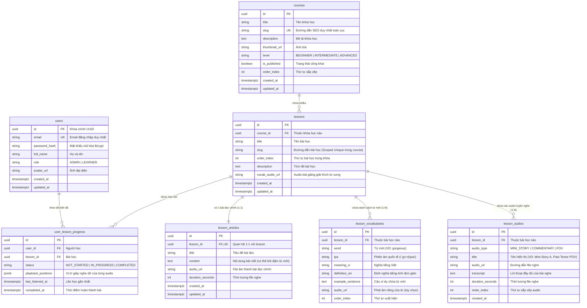

# 🗄️ 03. Database Schema & Data Dictionary (ERD)

Tài liệu thiết kế chi tiết cơ sở dữ liệu PostgreSQL cho dự án **SpeakUp**, bao gồm sơ đồ quan hệ thực thể (ERD), từ điển dữ liệu (Data Dictionary) giải thích tường tận mục đích của từng bảng và từng cột.

---

## 1. Sơ đồ quan hệ thực thể (ERD Diagram)

---

## 2. Từ điển Dữ liệu Chi tiết (Data Dictionary)

Dưới đây là giải thích chi tiết mục đích nghiệp vụ, ý nghĩa từng cột, kiểu dữ liệu và ví dụ thực tế cho toàn bộ 7 bảng trong hệ thống:

---

### 👤 BẢNG 1: `users` (Người dùng & Quản trị viên)
- **Nhiệm vụ:** Quản lý tài khoản đăng nhập, xác thực và phân quyền người dùng trong hệ thống.

| Tên Cột | Kiểu dữ liệu | Ràng buộc | Ý nghĩa & Ví dụ thực tế |
| :--- | :--- | :--- | :--- |
| `id` | `UUID` | **PK**, Default: `gen_random_uuid()` | Định danh duy nhất toàn cầu cho mỗi tài khoản. |
| `email` | `VARCHAR(255)` | **NOT NULL**, **UNIQUE**, Index | Email đăng nhập của người dùng. *(VD: `learner@example.com`)*. |
| `password_hash` | `VARCHAR(255)` | **NOT NULL** | Chuỗi mật khẩu đã được mã hóa an toàn bằng thuật toán Bcrypt. |
| `full_name` | `VARCHAR(100)` | **NOT NULL** | Tên hiển thị của người dùng trên giao diện. *(VD: `Nguyễn Cảnh Hùng`)*. |
| `role` | `VARCHAR(20)` | **NOT NULL**, Default: `'LEARNER'` | Quyền hạn: `ADMIN` (Được quyền thêm/sửa/xóa khóa học) hoặc `LEARNER` (Người học thông thường). |
| `avatar_url` | `VARCHAR(500)` | Nullable | Đường dẫn ảnh đại diện đại diện người dùng. |
| `created_at` | `TIMESTAMPTZ` | **NOT NULL**, Default: `NOW()` | Thời điểm tài khoản được khởi tạo. |
| `updated_at` | `TIMESTAMPTZ` | **NOT NULL**, Default: `NOW()` | Thời điểm tài khoản được cập nhật thông tin lần cuối. |

---

### 📚 BẢNG 2: `courses` (Khóa học)
- **Nhiệm vụ:** Lưu trữ thông tin danh mục các khóa học lớn trong ứng dụng (ví dụ: Effortless English Original, Power English, Business English).

| Tên Cột | Kiểu dữ liệu | Ràng buộc | Ý nghĩa & Ví dụ thực tế |
| :--- | :--- | :--- | :--- |
| `id` | `UUID` | **PK**, Default: `gen_random_uuid()` | Mã định danh duy nhất của khóa học. |
| `title` | `VARCHAR(200)` | **NOT NULL** | Tên đầy đủ của khóa học. *(VD: `Power English Course`)*. |
| `slug` | `VARCHAR(200)` | **NOT NULL**, **UNIQUE**, Index | Tên rút gọn thân thiện trên đường dẫn URL trình duyệt. *(VD: `power-english`)*. |
| `description` | `TEXT` | Nullable | Lời giới thiệu tổng quan, phương pháp và mục tiêu đầu ra của khóa học. |
| `thumbnail_url`| `VARCHAR(500)` | Nullable | Đường dẫn ảnh bìa của khóa học hiển thị ngoài trang chủ. |
| `level` | `VARCHAR(30)` | Default: `'INTERMEDIATE'` | Trình độ phù hợp: `BEGINNER`, `INTERMEDIATE`, `ADVANCED`. |
| `is_published` | `BOOLEAN` | Default: `false` | Cờ trạng thái: `true` là khóa học đã xuất bản (học viên nhìn thấy), `false` là bản nháp của Admin. |
| `order_index` | `INTEGER` | Default: `0` | Thứ tự ưu tiên sắp xếp hiển thị khóa học ngoài trang chủ (0, 1, 2...). |
| `created_at` | `TIMESTAMPTZ` | **NOT NULL**, Default: `NOW()` | Ngày tạo khóa học. |
| `updated_at` | `TIMESTAMPTZ` | **NOT NULL**, Default: `NOW()` | Ngày cập nhật khóa học. |

---

### 📖 BẢNG 3: `lessons` (Bài học trong khóa)
- **Nhiệm vụ:** Quản lý danh sách các bài học cụ thể thuộc về một khóa học.

| Tên Cột | Kiểu dữ liệu | Ràng buộc | Ý nghĩa & Ví dụ thực tế |
| :--- | :--- | :--- | :--- |
| `id` | `UUID` | **PK**, Default: `gen_random_uuid()` | Mã định danh duy nhất của bài học. |
| `course_id` | `UUID` | **NOT NULL**, **FK** ➔ `courses.id` | Khóa ngoại xác định bài học này thuộc về khóa học nào. |
| `title` | `VARCHAR(200)` | **NOT NULL** | Tên bài học. *(VD: `A Kiss`, `Bubba's Food`)*. |
| `slug` | `VARCHAR(200)` | **NOT NULL**, **UNIQUE(course_id, slug)** | Đường dẫn URL của bài học. Duy nhất trong khóa học đó. *(VD: `a-kiss`)*. |
| `order_index` | `INTEGER` | **NOT NULL**, Default: `1` | Số thứ tự bài trong khóa học (Bài 1, Bài 2...). |
| `description` | `TEXT` | Nullable | Tóm tắt ngắn gọn nội dung câu chuyện trong bài. |
| `vocab_audio_url`| `VARCHAR(500)`| Nullable | File âm thanh bài giảng giáo viên giải thích từ vựng trong bài (nếu bài đó có file audio từ vựng riêng). |
| `created_at` | `TIMESTAMPTZ` | **NOT NULL**, Default: `NOW()` | Ngày tạo bài học. |
| `updated_at` | `TIMESTAMPTZ` | **NOT NULL**, Default: `NOW()` | Ngày cập nhật bài học. |

---

### 📝 BẢNG 4: `lesson_articles` (1. Main Article - Bài đọc chính)
- **Nhiệm vụ:** Lưu nội dung văn bản chính và file nghe của bài đọc. Quan hệ 1:1 với `lessons` (mỗi bài học có duy nhất 1 bài đọc chính).

| Tên Cột | Kiểu dữ liệu | Ràng buộc | Ý nghĩa & Ví dụ thực tế |
| :--- | :--- | :--- | :--- |
| `id` | `UUID` | **PK**, Default: `gen_random_uuid()` | Mã định danh duy nhất của bài đọc. |
| `lesson_id` | `UUID` | **NOT NULL**, **UNIQUE**, **FK** ➔ `lessons.id` | Khóa ngoại liên kết 1-1 với bài học tương ứng. |
| `title` | `VARCHAR(200)` | **NOT NULL** | Tiêu đề của bài đọc chính. *(VD: `A Kiss - Main Story`)*. |
| `content` | `TEXT` | **NOT NULL** | Toàn bộ nội dung chữ của bài đọc. Cho phép nhúng thẻ HTML/Markdown để bôi đậm các từ mới *(VD: `Carlos bought a <mark>huge</mark> car.`)*. |
| `audio_url` | `VARCHAR(500)` | **NOT NULL** | Đường dẫn file âm thanh giọng đọc bản ngữ của bài đọc chính. |
| `duration_seconds`| `INTEGER` | Default: `0` | Thời lượng của file nghe tính bằng giây (VD: `345` giây = 5 phút 45 giây) để hiển thị thanh Audio Player. |
| `created_at` | `TIMESTAMPTZ` | **NOT NULL**, Default: `NOW()` | Ngày tạo bài đọc. |
| `updated_at` | `TIMESTAMPTZ` | **NOT NULL**, Default: `NOW()` | Ngày cập nhật bài đọc. |

---

### 💡 BẢNG 5: `lesson_vocabularies` (2. Danh sách Từ vựng trong bài)
- **Nhiệm vụ:** Lưu chi tiết từng từ mới xuất hiện trong bài đọc, phục vụ người học tra cứu, xem phiên âm IPA và câu ví dụ mẫu.

| Tên Cột | Kiểu dữ liệu | Ràng buộc | Ý nghĩa & Ví dụ thực tế |
| :--- | :--- | :--- | :--- |
| `id` | `UUID` | **PK**, Default: `gen_random_uuid()` | Mã định danh của từ vựng. |
| `lesson_id` | `UUID` | **NOT NULL**, **FK** ➔ `lessons.id`, Index | Thuộc bài học nào. |
| `word` | `VARCHAR(100)` | **NOT NULL** | Từ hoặc cụm từ mới. *(VD: `gorgeous`, `yell at`)*. |
| `ipa` | `VARCHAR(100)` | Nullable | Ký âm phiên âm quốc tế chuẩn IPA. *(VD: `/ˈɡɔːrdʒəs/`)*. |
| `meaning_vi` | `VARCHAR(255)` | **NOT NULL** | Nghĩa tiếng Việt ngắn gọn. *(VD: `cực kỳ xinh đẹp, lộng lẫy`)*. |
| `definition_en`| `TEXT` | Nullable | Định nghĩa bằng tiếng Anh đơn giản theo phong cách Effortless English. *(VD: `very, very beautiful`)*. |
| `example_sentence`| `TEXT` | Nullable | Câu ví dụ trích xuất từ chính bài đọc. *(VD: `She was a gorgeous girl with blonde hair.`)*. |
| `audio_url` | `VARCHAR(500)` | Nullable | File âm thanh phát âm riêng của từ đó khi người học bấm nút loa nghe phát âm chuẩn. |
| `order_index` | `INTEGER` | Default: `0` | Thứ tự xuất hiện của từ mới trong bài (từ đầu tiên ➔ từ tiếp theo). |

---

### 🎙️ BẢNG 6: `lesson_audios` (3. Mini Story, 4. Commentary, 5. Point of View)
- **Nhiệm vụ:** Bảng đa năng lưu trữ các file âm thanh luyện nghe kèm Transcript của bài học. Vì một bài học có thể có nhiều Mini Story, có hoặc không có Commentary/POV, nên gom vào bảng này giúp hệ thống linh hoạt tối đa.

| Tên Cột | Kiểu dữ liệu | Ràng buộc | Ý nghĩa & Ví dụ thực tế |
| :--- | :--- | :--- | :--- |
| `id` | `UUID` | **PK**, Default: `gen_random_uuid()` | Mã định danh của audio. |
| `lesson_id` | `UUID` | **NOT NULL**, **FK** ➔ `lessons.id`, Index | Thuộc bài học nào. |
| `audio_type` | `VARCHAR(30)` | **NOT NULL**, Index | Phân loại audio (ENUM): • `MINI_STORY`: Bài nghe hỏi đáp phản xạ (có thể có nhiều MS). • `COMMENTARY`: Bài chia sẻ cảm nghĩ mở rộng của tác giả. • `POV`: Bài nghe đổi ngôi / đổi thì (Point of View). |
| `title` | `VARCHAR(200)` | **NOT NULL** | Tên hiển thị trên giao diện *(VD: `Mini-Story A`, `Mini-Story B`, `Past Tense POV`)*. |
| `audio_url` | `VARCHAR(500)` | **NOT NULL** | Đường dẫn file MP3/WAV để phát nhạc. |
| `transcript` | `TEXT` | Nullable | Toàn bộ nội dung lời thoại (Transcript) để người học vừa nghe vừa theo dõi văn bản. |
| `duration_seconds`| `INTEGER` | Default: `0` | Thời lượng file nghe tính bằng giây. |
| `order_index` | `INTEGER` | Default: `0` | Thứ tự hiển thị các tab/nút nghe trong giao diện bài học. |
| `created_at` | `TIMESTAMPTZ` | **NOT NULL**, Default: `NOW()` | Ngày tạo file audio. |

---

### 📈 BẢNG 7: `user_lesson_progress` (Tiến độ học tập của người dùng)
- **Nhiệm vụ:** Theo dõi và ghi nhớ lộ trình học của từng cá nhân: bài nào đã xong, bài nào đang nghe dở và vị trí dừng phát.

| Tên Cột | Kiểu dữ liệu | Ràng buộc | Ý nghĩa & Ví dụ thực tế |
| :--- | :--- | :--- | :--- |
| `id` | `UUID` | **PK**, Default: `gen_random_uuid()` | Mã định danh bản ghi tiến độ. |
| `user_id` | `UUID` | **NOT NULL**, **FK** ➔ `users.id` | Học viên nào đang học. |
| `lesson_id` | `UUID` | **NOT NULL**, **FK** ➔ `lessons.id` | Đang học bài nào. |
| `status` | `VARCHAR(20)` | Default: `'NOT_STARTED'` | Trạng thái: `NOT_STARTED` (Chưa học), `IN_PROGRESS` (Đang học), `COMPLETED` (Đã hoàn thành). |
| `playback_positions`| `JSONB` | Default: `'{}'` | **Điểm sáng tính năng:** Lưu vị trí số giây đã nghe dở của từng audio dưới dạng JSON: `{"article": 125, "ms_a": 340, "pov": 45}`. Khi người học mở lại app, audio sẽ tự động tua đúng vị trí đang nghe dở! |
| `last_listened_at`| `TIMESTAMPTZ` | Default: `NOW()` | Lần cuối cùng người học bấm nghe bài này (dùng để sắp xếp mục *"Gần đây nhất"*). |
| `completed_at` | `TIMESTAMPTZ` | Nullable | Thời điểm người học đánh dấu đã hoàn thành bài học (dùng để thống kê chuỗi ngày Streak). |
| **Ràng buộc** | — | **UNIQUE(user_id, lesson_id)** | Mỗi học viên chỉ có duy nhất 1 bản ghi tiến độ cho mỗi bài học. |

---

## 3. Các Ràng buộc & Tối ưu Chỉ mục (Performance Indexes)

Tuân thủ nghiêm ngặt quy tắc [Backend API Rules](file:///d:/MY_PROJECT/speak-up/.agent/rules/backend-api-rules.md):

1. **`users(email)`:** `CREATE UNIQUE INDEX idx_users_email ON users(email);` ➔ Đăng nhập tức thì < 1ms.
2. **`courses(slug)`:** `CREATE UNIQUE INDEX idx_courses_slug ON courses(slug);` ➔ Truy vấn URL khóa học siêu tốc.
3. **`lessons(course_id, slug)`:** `CREATE UNIQUE INDEX idx_lessons_course_slug ON lessons(course_id, slug);` ➔ Đảm bảo toàn vẹn URL bài học.
4. **`lesson_audios(lesson_id, audio_type)`:** `CREATE INDEX idx_lesson_audios_composite ON lesson_audios(lesson_id, audio_type);` ➔ Tải nhanh danh sách audio theo bài.
5. **`user_lesson_progress(user_id, lesson_id)`:** `CREATE UNIQUE INDEX idx_user_progress ON user_lesson_progress(user_id, lesson_id);` ➔ Chống ghi trùng tiến độ.
