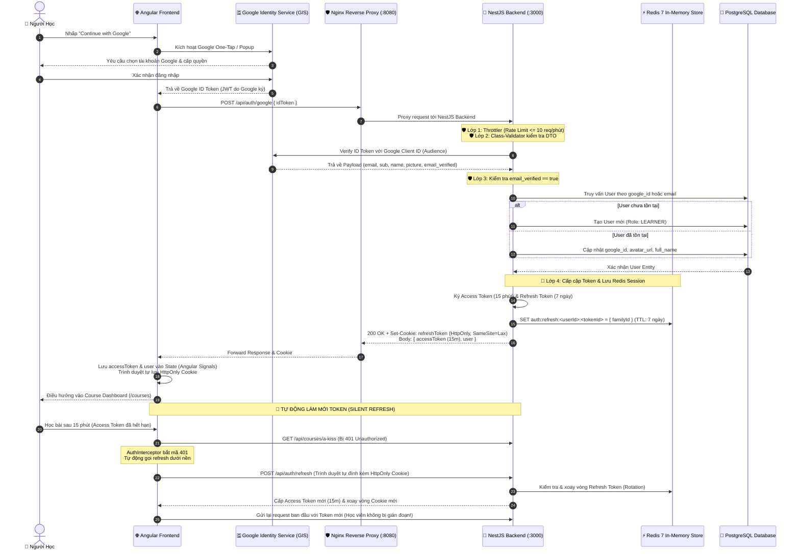

# 🔐 Kiến Trúc Xác Thực & Bảo Mật (Authentication & Security Architecture)

> **Tài liệu chuẩn kiến trúc số 04** — Hệ thống xác thực đăng nhập một chạm Google OAuth 2.0 kết hợp SpeakUp JWT Session, cơ chế phòng thủ đa tầng và kiến trúc quản lý phiên Hybrid Đa nền tảng (Web HttpOnly Cookie + Mobile App Keychain) bằng Redis.

---

## 🎯 1. Mục Đích & Nguyên Lý Thiết Kế

Hệ thống xác thực của SpeakUp được thiết kế nhằm đáp ứng 4 mục tiêu cốt lõi:
1. **Trải nghiệm người dùng mượt mà (Frictionless UX):** Đăng nhập một chạm với tài khoản Google (Google Identity Services - GIS) không cần nhớ mật khẩu.
2. **Bảo mật đa tầng (Defense in Depth):** Xác minh chữ ký số trực tiếp tại Backend, chống tấn công mạo danh (Confused Deputy), ngăn chặn brute-force và rò rỉ dữ liệu.
3. **Mô hình Hybrid Đa nền tảng (Web + Mobile Ready):**
   - **Web (Angular):** Dùng `HttpOnly Cookie` cho Refresh Token để miễn nhiễm hoàn toàn với các cuộc tấn công XSS.
   - **Mobile (Flutter / React Native):** Nhận Refresh Token trực tiếp qua JSON Body để lưu trữ an toàn trong phần cứng thiết bị (iOS Keychain / Android Keystore).
4. **Độc lập với hạ tầng triển khai (12-Factor App):** Cấu hình linh hoạt qua biến môi trường, sẵn sàng chạy mượt mà cả trên Localhost và Production Domain mà không cần sửa code.

---

## 🔄 2. Sơ Đồ Trình Tự End-to-End (Mermaid Sequence Diagram)



---

## 🏗️ 3. Chi Tiết Các Thành Phần Triển Khai

### 3.1. Frontend (`apps/web`)

| Thành phần | Đường dẫn | Trách nhiệm chính |
| :--- | :--- | :--- |
| **AuthService** | `core/services/auth.service.ts` | Khởi tạo GIS SDK, gọi API trao đổi token với `withCredentials: true`, quản lý `currentUser` và `token` qua Angular Signals. Cung cấp hàm `refreshToken()` và `logout()`. |
| **AuthGuard** | `core/guards/auth.guard.ts` | Functional Route Guard bảo vệ các route riêng tư (`/courses`, `/learn`). Nếu chưa đăng nhập, tự động chuyển hướng về `/login?returnUrl=...`. |
| **AuthInterceptor** | `core/interceptors/auth.interceptor.ts` | Functional HTTP Interceptor: <br/>1. Tự động đính kèm `Authorization: Bearer <accessToken>` vào mọi request `/api`.<br/>2. Khi nhận mã `401 Unauthorized`, tự động gọi âm thầm `/api/auth/refresh` và retry lại request gốc với token mới. |
| **LoginComponent** | `features/auth/login/login.component.ts` | Giao diện Split-Screen chuẩn Web Design Backbone, tự động render nút Google Sign-In đồng bộ theo Dark/Light Theme. |

### 3.2. Backend (`apps/api`)

| Thành phần | Đường dẫn | Trách nhiệm chính |
| :--- | :--- | :--- |
| **RedisService** | `common/redis/redis.service.ts` | Module Redis toàn cục (Global) quản lý kết nối tới `speakup-redis` bằng `ioredis`. Cung cấp các thao tác non-blocking: `set`, `get`, `del`, `delPattern` (SCAN stream). |
| **AuthController** | `modules/auth/auth.controller.ts` | Tiếp nhận `POST /auth/google`, `POST /auth/refresh`, `POST /auth/logout`, `GET /auth/me`. Xử lý Cookie HttpOnly cho Web và fallback Body cho Mobile. |
| **AuthService** | `modules/auth/auth.service.ts` | Xác thực Google Token, tạo cặp Token, kiểm tra whitelist và xoay vòng Refresh Token trong Redis, phát hiện tấn công tái sử dụng (Reuse Detection). |
| **JwtStrategy** | `modules/auth/strategies/jwt.strategy.ts` | Passport Strategy giải mã Bearer Token (15m), kiểm tra lại sự tồn tại của User trong PostgreSQL. |

---

## 🛡️ 4. Hệ Thống Phòng Thủ Đa Tầng (Defense in Depth)

Hệ thống được trang bị 7 lớp bảo vệ chống lại các hình thức tấn công phổ biến:

```
[HTTP Request từ Internet]
        │
        ▼
┌────────────────────────────────────────────────────────┐
│ 1. Nginx Reverse Proxy (Chặn request rác, che giấu IP) │
└───────────────────────┬────────────────────────────────┘
                        │
                        ▼
┌────────────────────────────────────────────────────────┐
│ 2. Helmet Security Headers (Chống Clickjacking, XSS)   │
└───────────────────────┬────────────────────────────────┘
                        │
                        ▼
┌────────────────────────────────────────────────────────┐
│ 3. Strict CORS Whitelist (Chỉ cho phép Domain tin cậy) │
└───────────────────────┬────────────────────────────────┘
                        │
                        ▼
┌────────────────────────────────────────────────────────┐
│ 4. Throttler Rate Limiter (Chống Brute-force & DoS)    │
└───────────────────────┬────────────────────────────────┘
                        │
                        ▼
┌────────────────────────────────────────────────────────┐
│ 5. Cookie-Parser & HttpOnly Cookie (Miễn nhiễm XSS)   │
└───────────────────────┬────────────────────────────────┘
                        │
                        ▼
┌────────────────────────────────────────────────────────┐
│ 6. Class Validator & Whitelist DTO (Chặn Injection)    │
└───────────────────────┬────────────────────────────────┘
                        │
                        ▼
┌────────────────────────────────────────────────────────┐
│ 7. Google Token Verify + Redis Token Rotation & Reuse  │
└────────────────────────────────────────────────────────┘
```

---

## ⚡ 5. Chi Tiết Mô Hình Hybrid Đa Nền Tảng & Redis Session

### 5.1. Cơ chế Hybrid (Web Cookie + Mobile Body):

Backend NestJS tự động phát hiện và hỗ trợ linh hoạt cho cả 2 nền tảng:

```typescript
// Trích đoạn từ AuthController:
const token = req.cookies?.['refreshToken'] || dto?.refreshToken;
```

1. **Khi Client là Website (Angular):**
   - Backend set `refreshToken` vào `HttpOnly Cookie`:
     - `httpOnly: true`: JavaScript không thể đọc được $\rightarrow$ Miễn nhiễm 100% với XSS.
     - `sameSite: 'lax'`: Ngăn chặn tấn công CSRF.
     - `path: '/api/auth'`: Trình duyệt chỉ gửi cookie khi gọi các endpoint xác thực, không làm phình to payload của các request bài học thông thường.
2. **Khi Client là Mobile App (Flutter / React Native):**
   - Mobile App gửi nhận `refreshToken` trực tiếp qua JSON Body/Header.
   - Mobile App lưu trữ token vào phần cứng an toàn: **iOS Keychain** hoặc **Android EncryptedSharedPreferences (Keystore)**.

### 5.2. Cấu trúc lưu trữ dữ liệu trong Redis:

| Key Pattern | Data Type | Giá trị lưu trữ | TTL (Thời gian sống) | Mục đích |
| :--- | :--- | :--- | :--- | :--- |
| `auth:refresh:<userId>:<tokenId>` | `String` | `{"familyId": "...", "createdAt": 177...}` | 7 ngày (`604800s`) | Whitelist các phiên đăng nhập hợp lệ. |

### 5.3. Cơ chế Xoay Vòng & Phát Hiện Trộm Token (Rotation & Reuse Detection):
- **Rotation (Xoay vòng):** Mỗi lần gọi `/api/auth/refresh`, Redis xóa ngay key cũ và nạp key mới.
- **Reuse Detection (Phát hiện tái sử dụng):** Nếu một Refresh Token cũ đã bị xoay vòng mà đột ngột xuất hiện lại trong một request $\rightarrow$ Chứng tỏ token này đã bị kẻ xấu đánh cắp và cố tình sử dụng lại. Hệ thống sẽ **ngay lập tức xóa sạch toàn bộ các phiên của tài khoản đó trong Redis (`delPattern("auth:refresh:<userId>:*")`)** và khóa phiên ngay tức khắc.

### 5.4. Đăng xuất tức thì (Instant Revocation):
Khi người dùng bấm *"Sign Out"*, Redis xóa key `auth:refresh:<userId>:<tokenId>` chỉ mất **dưới 1ms**. Trình duyệt xóa Cookie và Access Token bị vô hiệu hóa khi hết hạn 15m.

---

## 🚀 6. Checklist Khi Đưa Lên Môi Trường Production

Khi chuẩn bị đưa dự án lên máy chủ thật (Production Server / Cloud), cần hoàn tất danh sách kiểm tra sau:

- [ ] **Google Cloud Console:**
  - Thêm tên miền thật vào mục *Authorized JavaScript origins* (ví dụ: `https://speakup.vn`).
  - Thêm URL redirect vào mục *Authorized redirect URIs*.
- [ ] **Cấu hình File `.env` trên Server:**
  - `NODE_ENV=production` (Khi đó cookie sẽ tự động bật cờ `secure: true` ép chạy qua HTTPS).
  - `JWT_SECRET`: Chuỗi bảo mật ngẫu nhiên cao (tối thiểu 64 ký tự).
  - `JWT_REFRESH_SECRET`: Chuỗi bảo mật riêng biệt cho Refresh Token.
  - `ALLOWED_ORIGINS=https://speakup.vn,https://www.speakup.vn`
- [ ] **Docker Compose:**
  - Bỏ biến môi trường `NODE_TLS_REJECT_UNAUTHORIZED="0"` trong container `api`.
- [ ] **HTTPS / SSL:**
  - Cấu hình chứng chỉ SSL Let's Encrypt trên Nginx để mã hóa toàn bộ cookie và traffic.
