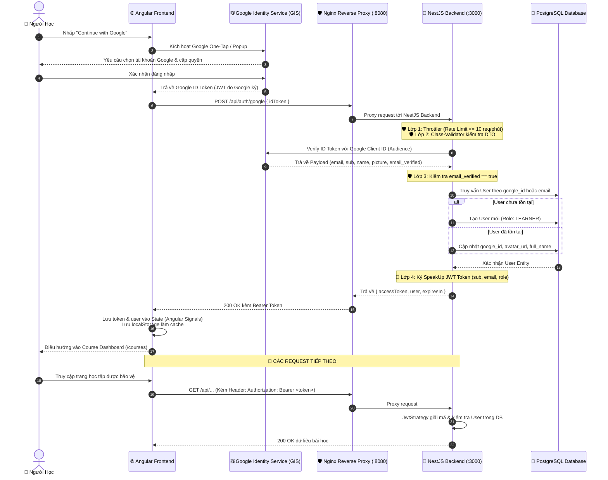

# 🔐 Kiến Trúc Xác Thực & Bảo Mật (Authentication & Security Architecture)

> **Tài liệu chuẩn kiến trúc số 04** — Hệ thống xác thực đăng nhập một chạm Google OAuth 2.0 kết hợp SpeakUp JWT Session và cơ chế phòng thủ đa tầng.

---

## 🎯 1. Mục Đích & Nguyên Lý Thiết Kế

Hệ thống xác thực của SpeakUp được thiết kế nhằm đáp ứng 3 mục tiêu cốt lõi:
1. **Trải nghiệm người dùng mượt mà (Frictionless UX):** Đăng nhập một chạm với tài khoản Google (Google Identity Services - GIS) không cần nhớ mật khẩu.
2. **Bảo mật đa tầng (Defense in Depth):** Xác minh chữ ký số trực tiếp tại Backend, chống tấn công mạo danh (Confused Deputy), ngăn chặn brute-force và rò rỉ dữ liệu.
3. **Độc lập với hạ tầng triển khai (12-Factor App):** Cấu hình linh hoạt qua biến môi trường, sẵn sàng chạy mượt mà cả trên Localhost và Production Domain mà không cần sửa code.

---

## 🔄 2. Sơ Đồ Trình Tự End-to-End (Mermaid Sequence Diagram)



---

## 🏗️ 3. Chi Tiết Các Thành Phần Triển Khai

### 3.1. Frontend (`apps/web`)

| Thành phần | Đường dẫn | Trách nhiệm chính |
| :--- | :--- | :--- |
| **AuthService** | `core/services/auth.service.ts` | Khởi tạo GIS SDK, gọi API trao đổi token, quản lý trạng thái đăng nhập phản ứng (Reactive) qua Angular Signals (`currentUser`, `isAuthenticated`). |
| **AuthGuard** | `core/guards/auth.guard.ts` | Functional Route Guard bảo vệ các route riêng tư (`/courses`, `/learn`). Nếu chưa đăng nhập, tự động chuyển hướng về `/login?returnUrl=...`. |
| **AuthInterceptor** | `core/interceptors/auth.interceptor.ts` | Functional HTTP Interceptor: <br/>1. Tự động đính kèm `Authorization: Bearer <token>` vào mọi request gửi tới `/api`.<br/>2. Bắt lỗi `401 Unauthorized` tập trung để tự động logout và đẩy về trang đăng nhập. |
| **LoginComponent** | `features/auth/login/login.component.ts` | Giao diện Split-Screen chuẩn Web Design Backbone, tự động render nút Google Sign-In đồng bộ theo Dark/Light Theme. |

### 3.2. Backend (`apps/api`)

| Thành phần | Đường dẫn | Trách nhiệm chính |
| :--- | :--- | :--- |
| **AuthController** | `modules/auth/auth.controller.ts` | Tiếp nhận request `POST /api/auth/google` và `GET /api/auth/me`. Áp dụng Rate Limit riêng. |
| **AuthService** | `modules/auth/auth.service.ts` | Xác thực Google ID Token qua `OAuth2Client.verifyIdToken()`, kiểm tra `email_verified`, upsert user vào PostgreSQL, cấp phát JWT Bearer Token. |
| **JwtStrategy** | `modules/auth/strategies/jwt.strategy.ts` | Passport Strategy giải mã Bearer Token, kiểm tra lại sự tồn tại của User trong PostgreSQL để đảm bảo tài khoản không bị xóa/khóa giữa chừng. |
| **JwtAuthGuard** | `modules/auth/guards/jwt-auth.guard.ts` | Guard bảo vệ các Controller/Endpoint nội bộ bằng JWT. |

---

## 🛡️ 4. Hệ Thống Phòng Thủ Đa Tầng (Defense in Depth)

Hệ thống được trang bị 6 lớp bảo vệ chống lại các hình thức tấn công phổ biến:

```
[HTTP Request từ Internet]
        │
        ▼
┌────────────────────────────────────────────────────────┐
│ 1. Nginx Reverse Proxy (Chặn request rác, che giấu IP) │
└───────────────────────┬────────────────────────────────┘
                        │
                        ▼
┌────────────────────────────────────────────────────────┐
│ 2. Helmet Security Headers (Chống Clickjacking, XSS)   │
└───────────────────────┬────────────────────────────────┘
                        │
                        ▼
┌────────────────────────────────────────────────────────┐
│ 3. Strict CORS Whitelist (Chỉ cho phép Domain tin cậy) │
└───────────────────────┬────────────────────────────────┘
                        │
                        ▼
┌────────────────────────────────────────────────────────┐
│ 4. Throttler Rate Limiter (Chống Brute-force & DoS)    │
└───────────────────────┬────────────────────────────────┘
                        │
                        ▼
┌────────────────────────────────────────────────────────┐
│ 5. Class Validator & Whitelist DTO (Chặn Injection)    │
└───────────────────────┬────────────────────────────────┘
                        │
                        ▼
┌────────────────────────────────────────────────────────┐
│ 6. Google ID Token Verification + email_verified Check │
└────────────────────────────────────────────────────────┘
```

1. **Chống tấn công Confused Deputy:**
   Backend chỉ chấp nhận token có `audience` khớp chính xác với `GOOGLE_CLIENT_ID` của SpeakUp. Kẻ xấu không thể dùng token cấp cho website khác để đăng nhập.
2. **Chống Account Takeover:**
   Bắt buộc kiểm tra `payload.email_verified === true`. Từ chối các tài khoản Google chưa hoàn tất xác thực email.
3. **Chống Brute-force & DoS:**
   Sử dụng `@nestjs/throttler`:
   - Toàn hệ thống: Tối đa 100 requests/phút.
   - Endpoint đăng nhập `POST /api/auth/google`: Tối đa 10 lần/phút/IP.
4. **Bảo vệ HTTP Headers với Helmet:**
   Tự động gán các headers bảo mật: `X-Content-Type-Options: nosniff`, `X-Frame-Options: SAMEORIGIN`, `Strict-Transport-Security`.
5. **CORS Whitelist linh hoạt:**
   Chỉ cho phép các origin hợp lệ (`ALLOWED_ORIGINS`). Tự động tương thích khi chạy Localhost hoặc cấu hình domain thật qua biến môi trường.
6. **Bảo mật dữ liệu nhạy cảm (Principle of Least Privilege):**
   User mới luôn có role mặc định là `LEARNER`. Mọi DTO trả về đều loại bỏ hoàn toàn các trường nhạy cảm (`passwordHash`).

---

## 🚀 5. Checklist Khi Đưa Lên Môi Trường Production

Khi chuẩn bị đưa dự án lên máy chủ thật (Production Server / Cloud), cần hoàn tất danh sách kiểm tra sau:

- [ ] **Google Cloud Console:**
  - Thêm tên miền thật vào mục *Authorized JavaScript origins* (ví dụ: `https://speakup.vn`).
  - Thêm URL redirect vào mục *Authorized redirect URIs*.
- [ ] **Cấu hình File `.env` trên Server:**
  - `NODE_ENV=production`
  - `JWT_SECRET`: Đổi thành chuỗi ký tự ngẫu nhiên bảo mật cao (tối thiểu 64 ký tự).
  - `ALLOWED_ORIGINS=https://speakup.vn,https://www.speakup.vn`
- [ ] **Docker Compose:**
  - Bỏ biến môi trường `NODE_TLS_REJECT_UNAUTHORIZED="0"` trong container `api` (biến này chỉ dùng cho môi trường dev khi bị proxy công ty chặn cert).
- [ ] **HTTPS / SSL:**
  - Cấu hình chứng chỉ SSL Let's Encrypt trên Nginx để toàn bộ traffic được mã hóa HTTPS.
