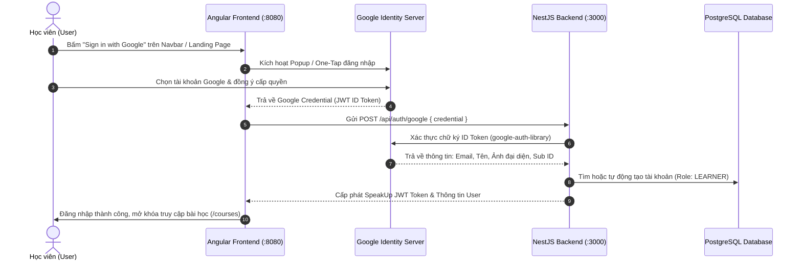

# 🔐 Hướng Dẫn Chi Tiết Cấu Hình Google OAuth 2.0 Cho SpeakUp

> **Mục tiêu:** Hướng dẫn chi tiết từng bước tạo **Google Client ID** trên Google Cloud Console để kích hoạt tính năng **Đăng nhập bằng tài khoản Google (Google Sign-In)** cho dự án SpeakUp.

---

## 📌 1. Tổng Quan Kiến Trúc Google OAuth 2.0 Trong SpeakUp

Dự án SpeakUp sử dụng chuẩn mới nhất của Google là **Google Identity Services (GIS)** kết hợp xác thực mã hóa an toàn ở Backend:



---

## 🛠️ 2. Các Bước Tạo Google Client ID Trên Google Cloud Console

### Bước 2.1: Truy cập và Tạo Dự án mới (Project)
1. Truy cập vào **[Google Cloud Console](https://console.cloud.google.com/)**.
2. Đăng nhập bằng tài khoản Gmail của bạn.
3. Ở thanh menu trên cùng, bấm vào danh sách chọn dự án (Select a project) ➔ Bấm **New Project** (Dự án mới).
4. Đặt tên dự án: `SpeakUp English` ➔ Bấm **Create** (Tạo).
5. Chờ vài giây rồi chọn dự án `SpeakUp English` vừa tạo.

---

### Bước 2.2: Cấu hình Màn hình chấp thuận OAuth (OAuth Consent Screen)
*Google yêu cầu bước này để người dùng biết ứng dụng nào đang yêu cầu xem thông tin tài khoản.*

1. Trong thanh tìm kiếm hoặc menu bên trái, vào **APIs & Services** ➔ Chọn **OAuth consent screen** (Màn hình chấp thuận OAuth).
2. Tại mục **User Type**, chọn **External** (Người dùng bên ngoài) ➔ Bấm **Create**.
3. Điền thông tin cơ bản:
   - **App name (Tên ứng dụng):** `SpeakUp`
   - **User support email (Email hỗ trợ người dùng):** Chọn email của bạn.
   - **Developer contact information (Thông tin liên hệ của nhà phát triển):** Nhập email của bạn.
   - *(Các mục App logo, App domain có thể để trống khi đang dev)*.
   - Bấm **Save and Continue** (Lưu và tiếp tục).
4. **Mục Scopes (Phạm vi):**
   - Bấm **Add or Remove Scopes** (Thêm hoặc xóa phạm vi).
   - Tích chọn 3 quyền cơ bản:
     - `.../auth/userinfo.email` (Xem địa chỉ email)
     - `.../auth/userinfo.profile` (Xem thông tin cá nhân cơ bản: tên, avatar)
     - `openid` (Xác thực tài khoản)
   - Bấm **Update** ➔ Bấm **Save and Continue**.
5. **Mục Test Users (Người dùng thử nghiệm):**
   - Khi ở chế độ thử nghiệm (Testing), chỉ các email được thêm vào danh sách này mới đăng nhập được.
   - Bấm **Add Users** ➔ Thêm chính địa chỉ email Gmail của bạn và các email bạn muốn dùng thử nghiệm.
   - Bấm **Save and Continue** ➔ Bấm **Back to Dashboard**.

---

### Bước 2.3: Tạo Thông tin xác thực (OAuth 2.0 Client ID)

1. Ở thanh menu bên trái, chọn **Credentials** (Thông tin xác thực).
2. Bấm vào nút **+ Create Credentials** (Tạo thông tin xác thực) ở trên cùng ➔ Chọn **OAuth client ID**.
3. Điền thông tin cấu hình:
   - **Application type (Loại ứng dụng):** Chọn **Web application** (Ứng dụng web).
   - **Name (Tên):** `SpeakUp Web Client`.
   - **Authorized JavaScript origins (Nguồn gốc JavaScript được ủy quyền):**  
     *Đây là bước cực kỳ quan trọng, nếu thiếu sẽ bị lỗi `origin_mismatch`.*  
     Bấm **+ Add URI** và thêm các địa chỉ sau:
     - `http://localhost:8080` *(Cổng chạy chính thức qua Nginx)*
     - `http://localhost:4200` *(Cổng chạy trực tiếp Angular dev)*
     - `http://localhost`
     - `http://127.0.0.1:8080`
   - **Authorized redirect URIs (URI chuyển hướng được ủy quyền):**  
     Vì chúng ta dùng thư viện popup/one-tap Google Identity Services nên không bắt buộc redirect URI, nhưng bạn có thể thêm:
     - `http://localhost:8080/api/auth/google/callback`
     - `http://localhost:8080`
4. Bấm nút **Create** (Tạo).

---

### Bước 2.4: Sao chép Client ID vào file `.env`

1. Sau khi bấm **Create**, một cửa sổ popup sẽ xuất hiện hiển thị:
   - **Your Client ID:** Dạng chuỗi dài kết thúc bằng `.apps.googleusercontent.com`  
     *(Ví dụ: `1234567890-abcdefghijklmn.apps.googleusercontent.com`)*.
   - **Your Client Secret:** Dạng chuỗi bí mật.
2. Sao chép chuỗi **Client ID**.
3. Mở file `.env` trong thư mục gốc dự án SpeakUp, dán Client ID vào:
   ```env
   # --- 7. GOOGLE OAUTH 2.0 CREDENTIALS ---
   GOOGLE_CLIENT_ID=1234567890-abcdefghijklmn.apps.googleusercontent.com
   ```
4. Lưu file `.env`.

---

## ⚠️ 3. Bắt Lỗi Thường Gặp (Troubleshooting)

| Lỗi gặp phải | Nguyên nhân gốc rễ | Cách khắc phục |
|---|---|---|
| **`origin_mismatch` / `Error 400: origin_mismatch`** | Trình duyệt truy cập từ cổng chưa được khai báo trong Google Cloud. | Vào lại **Credentials** ➔ Bấm sửa OAuth Client ID ➔ Kiểm tra mục **Authorized JavaScript origins** đã có đúng `http://localhost:8080` hay chưa. |
| **`access_denied` / `403 Forbidden`** | Đang ở chế độ Test mà email đăng nhập chưa được thêm vào Test Users. | Vào lại **OAuth consent screen** ➔ Mục **Test users** ➔ Thêm email Gmail bạn đang dùng để thử nghiệm vào danh sách. |
| **Popup tự đóng không phản hồi** | Trình duyệt chặn cookie bên thứ 3 hoặc chặn popup. | Cho phép popup từ `accounts.google.com` trong cài đặt trình duyệt. |

---

*Sau khi cấu hình xong file `.env`, hệ thống SpeakUp đã hoàn toàn sẵn sàng cho việc kết nối giao diện và API ở các bước tiếp theo!*
